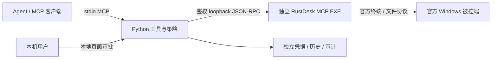

# RustDesk MCP 0.2.0

独立 Windows x64 EXE + Python MCP，通过官方 RustDesk 连接、终端和文件协议操作远端 Windows。
提供 **40 个 MCP 工具**、本地审批/监视页面、独立多会话和持久历史。
与官方桌面版并用，不安装服务、不替换官方 EXE、不写回官方配置。

## 交付入口

- [交付与使用手册](docs/delivery-guide.md)：原理、功能、安装、MCP/EXE 用法、编译、升级与故障排查。
- [API 参考](docs/api-reference.md) / [完整 schema](docs/tools-schema.json)：全部 40 个接口及参数。
- [验证记录](docs/validation-record.md)：已实测和未实测条件。
- [开发进度](docs/development-plan.md)：额度中断后从这里继续。
- [配置来源](docs/configuration.md)、[环境管理](docs/build-environment.md)、[共存与升级](docs/installation-and-upgrades.md)。
- [PRD](docs/PRD.md)、[接口调查](docs/interface-review.md)：产品边界、Kimi 工具参考和主线合并策略。

产物目录：`build/mcp-dist/0.2.0-rustdesk-1.5.0/`。
交付包：`build/mcp-dist/rustdesk-mcp-0.2.0-windows-x64.zip`。
需要已有 Python 3.11+、uv；安装器在交付目录创建独立虚拟环境。

## 原理



每个连接使用独立 EXE，默认最多 4 个会话。同一终端一次一个操作，忙时返回 busy。
EXE 负责连接/通道，MCP 负责诊断、文件、脚本、哈希保护、审批和分页。
EXE 没有完整 RustDesk GUI，也不是 MCP stdio 服务；通常由 MCP 自动启动。

## 快速使用

源码目录已构建时：

```powershell
pwsh -NoProfile -File mcp/scripts/configure.ps1 -ConfigSource official
pwsh -NoProfile -File mcp/scripts/dev.ps1 python -m rustdesk_mcp.app --help
```

交付 ZIP 解压后：

```powershell
pwsh -NoProfile -File scripts/install.ps1 -Configure
```

安装器生成 `client-config.json`。把其中 command/args 加入 MCP 客户端，先 connect，再使用返回的 session_id。
默认只读。自由命令、写入、传输到本地、脚本/处置需开启写策略，随后逐次在本地页面审批。
页面地址输出到 MCP stderr，stdout 只承载 MCP 协议。详细步骤见交付手册。

## 从源码生成

```powershell
pwsh -NoProfile -File mcp/scripts/bootstrap-build.ps1
pwsh -NoProfile -File mcp/scripts/build.ps1
pwsh -NoProfile -File mcp/scripts/build.ps1 -FeatureOff
pwsh -NoProfile -File mcp/scripts/dev.ps1 python -m unittest discover -s mcp/server/tests
pwsh -NoProfile -File mcp/scripts/package.ps1
```

复用已有 VS C++/Python/uv；Rust、vcpkg、辅助包和缓存放在项目内。
所有环境设置仅对子进程生效，不要 dot-source 或在常用 shell 中直接 & 调用环境脚本。
与上游既有代码的交界只涉及四个薄入口文件，不改共享 protobuf、hbb_common 或 Flutter。

## 边界

不提供 GUI、桌面点击/键鼠、交互式 TUI、目录传输/自动续传、无凭据提权或任意后台进程托管。
管理员及外部 API key 的成功路径需要对应凭据；真实安装/卸载、系统处置和扫描本轮未执行。
取消确认的是本项目终端关闭，不回滚修改，也不保证结束脱离终端的进程或交给系统服务的任务。
文件覆盖保留备份，但不承诺断电原子性。保留运行数据和操作历史，避免破坏去重。
