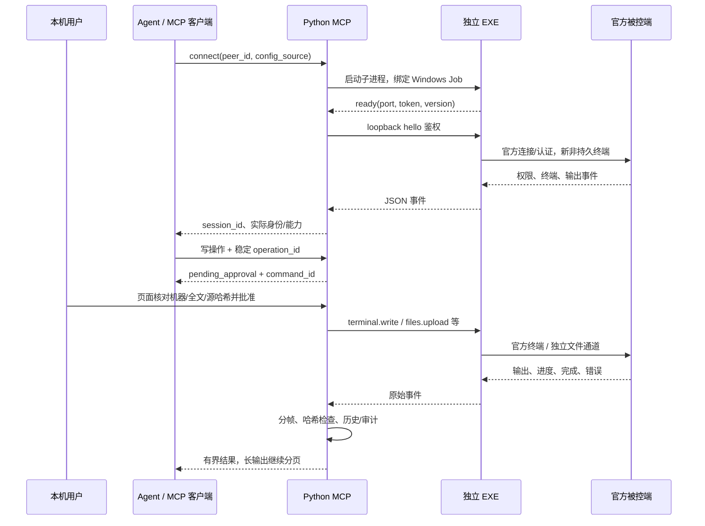

# RustDesk MCP 0.2.0 交付与使用手册

## 1. 交付了什么

| 文件 | 用途 |
|---|---|
| rustdesk-mcp-bridge.exe | 独立 Windows x64 连接、终端和文件桥接 |
| rustdesk_mcp_server-0.2.0-py3-none-any.whl | Python MCP，40 个业务工具 |
| manifest.json | EXE/wheel SHA256、版本、编译器、源码标识 |
| runtime-requirements.txt | uv.lock 导出的完整依赖及哈希 |
| scripts/install.ps1 | 创建本版本独立 Python 运行环境 |
| scripts/run.ps1 | 手工启动 MCP stdio |
| scripts/configure.ps1 | 配置官方/私有来源、DPAPI 连接/管理员凭据 |
| docs/ | 原理、接口、验证、配置、环境、升级与进度 |
| LICENCE | 上游 AGPL-3.0；分发保留许可并提供对应源码 |

本产品 EXE/Python 版本 0.2.0，桥接协议 1.1，RustDesk 源码基线 1.5.0。
被控端版本另行探测，本轮验收使用官方 RustDesk 1.4.8。
这是本地开发交付，未做代码签名；构建源码标识含 HEAD 与 dirty 状态，最终 Git 提交另外记录。

## 2. EXE 与 MCP 交互原理



Agent 与 Python 使用 MCP stdin/stdout。EXE 的 stdout 只发送启动 ready，
控制走随机端口的 127.0.0.1 TCP、随机 token、JSON-RPC NDJSON。
token 不进命令行/文件。stdin EOF 或控制连接断开让 EXE 退出；Python 使用 Windows Job 管理子进程。
正常退出先关闭本项目远端终端，并如实报告是否收到关闭回执。

每个连接拥有独立 EXE、一个新终端、按需一个文件会话。默认最多 4 个会话，max_sessions 可设 1–16。
同一终端一次一个操作，busy 不隐式排队；不同会话可以并行。
同一 peer 可开不同终端，不接管官方用户的持久终端或桌面。
同一 data_dir 只能运行一个 MCP 实例，第二个返回 runtime_in_use；另一个实例可指定独立 --data-dir。

## 3. EXE 能实现什么，怎样使用

- 只读读取官方服务器、公钥、网络配置及已保存 peer 认证 hash，或使用 MCP 私有凭据。
- 官方连接/认证，报告加密、权限、对端信息、挑战和错误。
- 打开/输入/调整尺寸/关闭新非持久终端，转发原始输出和关闭事件。
- 独立官方文件会话：上传/下载单文件、进度、完成、错误与覆盖挑战。
- 原生目录/创建/重命名/非递归删除原语；MCP 文件策略主要由受控 PowerShell 实现。

EXE 不保存业务历史，不解析 PowerShell 结果，没有桌面窗口或 Web 页面。
它链接上游客户端库，但不会向外提供全部 RustDesk GUI 功能。
把它放在主控电脑，由 MCP 自动启动；被控端仍使用官方 RustDesk，开启授权使用的终端/文件权限。

手工运行 `rustdesk-mcp-bridge.exe --mcp-bridge` 会输出 ready。
需保持 stdin 打开，并在 30 秒内连接 ready 端口、发送 hello；原语见 bridge-protocol.md。
双击后关闭/没有窗口并不意味着没编译成功。它不直接处理 MCP initialize/tools/list，客户端应启动 Python。

## 4. MCP 功能清单

40 个工具的参数见 api-reference.md / tools-schema.json。

| 场景 | 能力 |
|---|---|
| 连接与任务 | 连接、断开、状态、多会话、执行、分页、取消、历史与审计 |
| 文件开发 | 目录/元数据、文本读写/精确替换、编码/BOM/换行、哈希保护、文件名/内容搜索 |
| 传输 | 官方单文件上传/下载、不可变来源快照、哈希校验、覆盖备份、进度 |
| 诊断 | 系统、进程、服务、软件、启动项、网络、事件、哈希/签名、Defender 状态 |
| 脚本部署 | PS1 全文审批、标量参数、runbooks、可信下载、便携 PS7、产物清理 |
| 处置 | 受审进程结束/服务控制/Defender 扫描，管理员连接独立审批 |
| 可选情报 | 配置 API key 后仅发送 SHA256 查询 VirusTotal，不上传文件 |

内置 hello/install_msi/uninstall_msi runbooks；其他安装器写成有明确成功条件、非交互参数的 PS1。
不存在自动识别任意安装器的万能安装/卸载接口。先用 hello 验证上传、执行、中文和清理。

## 5. 安装包与 MCP 客户端注册

主控需要 Windows x64、已有 Python 3.11+ 和 uv。安装器禁止自动下载 Python，
不修改系统 PATH、不向系统 Python 安装依赖、不安装 VS/Rust。

1. ZIP 解压到新版本目录，例如 `C:\Tools\RustDeskMCP\0.2.0\`。
2. 核对 manifest 的 EXE/wheel SHA256；安装器会再检查。
3. 在版本目录启动子进程运行：

```powershell
pwsh -NoProfile -File scripts/install.ps1 -Configure
# 或指定已有 Python：
pwsh -NoProfile -File scripts/install.ps1 -PythonExe C:/existing/python.exe -Configure
```

安装器创建 runtime/、cache/，按带哈希的锁定清单安装依赖，再安装 wheel。
-Configure 采用 official、关闭写策略并保留已有 profiles；已有 runtime 时拒绝覆盖，升级用新目录。
不传 -Configure 时可以稍后配置；无配置也可发现工具，连接会明确报错。

安装后生成 client-config.json：

```json
{
  "mcpServers": {
    "rustdesk": {
      "command": "C:/Tools/RustDeskMCP/0.2.0/runtime/Scripts/python.exe",
      "args": ["-m", "rustdesk_mcp.app", "--bridge-exe", "C:/Tools/RustDeskMCP/0.2.0/rustdesk-mcp-bridge.exe"]
    }
  }
}
```

把 rustdesk 项合入已有客户端配置，保留其他 MCP。客户端的外层容器可能不同，command/args 使用生成的绝对路径。
Kimi 源码确认支持 stdio command/args，省略 transport 会推断 stdio；添加界面填这两项即可。
本轮没有更改用户现有 Kimi 全局配置。实际界面的 Agent 调用仍需客户端侧验收。
手工启动 `pwsh -NoProfile -File scripts/run.ps1` 后等待 MCP 输入属于正常现象，不是 GUI。
优先让客户端直接启动 runtime Python，避免 shell 额外输出污染协议。

## 6. 官方、自定义与管理员配置

```powershell
# 官方只读来源
pwsh -NoProfile -File scripts/configure.ps1 -ConfigSource official `
  -BridgeExe C:/Tools/RustDeskMCP/0.2.0/rustdesk-mcp-bridge.exe

# 私有来源；密码由 SecureString 交互输入
pwsh -NoProfile -File scripts/configure.ps1 -ConfigSource profile -PeerId '<目标 ID>' `
  -CredentialRef office -Server '<服务器地址>' -ServerKey '<服务器公钥>' `
  -BridgeExe C:/Tools/RustDeskMCP/0.2.0/rustdesk-mcp-bridge.exe
```

官方模式要求已经保存有效 peer 密码；缺少返回 official_credential_unavailable，应用 PIN/锁定明确拒绝。
私有模式 connect 传 credential_ref=office、config_source=profile。
official 加 credential_ref=office 可只覆盖密码，仍用官方服务器。服务器公钥不是管理 API token。

写策略需配置时加 -AllowWrites，开启后仍逐次审批，不是放开自动执行。
管理员 OS 账户另配：

```powershell
pwsh -NoProfile -File scripts/configure.ps1 -ConfigSource official -AdminPeerId '<目标 ID>' `
  -AdminCredentialRef admin-office -AdminUsername '<域\管理员或本地账户>' -AllowWrites `
  -BridgeExe C:/Tools/RustDeskMCP/0.2.0/rustdesk-mcp-bridge.exe
```

交互提示 OS 密码。connect 传 elevate=true、admin_credential_ref=admin-office，先返回 pending_approval。
在本地页面批准后才发送管理员认证；权限以实际 SID/administrator 为准，不绕过 UAC/远端策略。
管理员终端不意味着文件通道具备同等权限，文件访问另行验证。

## 7. 典型操作流程

1. connect，保存 session_id，核对 peer、身份、SID、shell 和权限。
2. 用固定 get_system_info/list_processes/list_services/read_file 等只读工具诊断。
3. 修改前读取文件及 sha256，write_file/edit_file 带该 expected_sha256。
4. 提交时使用稳定唯一 operation_id，例如 repair-config-20261007-01。
5. pending_approval 后打开 approval-url.txt 中的本地页面（见第 8 节），核对完整命令/内容/目录/来源哈希再批准。
6. get_command_output 有限等待和分页；running 继续查询，查询超时不会停止操作。
7. unknown 先核查远端，不能换 ID 自动重执行。相同 ID/参数重试返回原记录，改参数返回 conflict。
8. cancel_command 关闭本项目终端，收到关闭回执才确认；之后新 connect。取消不回滚修改。
9. 脚本默认 keep；cleanup_artifacts(command_id=原脚本/部署命令) 另行审批，只清理记录产物。
10. disconnect。历史仍可用原 session_id/command_id 查询，新会话不能接管旧操作。

文本 offset 按 Unicode codepoint，每页最多 4096 codepoint；命令输出每页最多 32 KiB、最多保留 8 MiB。
大结构化结果也可能 running/JSON 分页，拼完整页再解析。搜索有深度、条数、大小、时间上限，不跟随重解析目录。
默认创建排他；覆盖/追加需当前哈希并保留 `.rdmcp.<标识>.bak`。
覆盖/跨卷创建不承诺断电原子性，失败可能有部分产物。下载仅到本地新路径，不覆盖已存在文件。

## 8. Web 审批与监视

监听 127.0.0.1 随机端口，URL fragment 带临时 token，页面读取后从地址中移除。
含 token 的完整地址写入数据目录 `approval-url.txt`（目录已限当前用户 ACL），stderr 只提示该文件路径，不回显 token。
多会话状态、审批全文、输出尾部/传输进度、拒绝、取消、断开、最近 30 项历史和输出分页。
完整历史通过 list_commands，审计通过 list_audit_events。检查 Bearer/Host，写 API 额外检查 Origin。
token 属于本机当前用户权限边界，不是防御同一 Windows 账户恶意程序的独立安全沙箱。

Agent 以 YOLO/全自动模式运行时，设 `auto_approve`（见 configuration.md）可跳过人工审批：
写操作与管理员连接自动批准并落审计，本页面转为纯监视/取消/断开用途。

## 9. 下载、便携 PS7 与清理

downloads.enabled 默认 false。download_url 仅接受受信 manifest 的 asset_ref、HTTPS 来源、固定 SHA256、
允许的重定向域名和大小上限。可配置镜像，预期哈希必须来自受信来源。
便携部署固定 7.4.20/x64，哈希来自[微软官方 release](https://github.com/PowerShell/PowerShell/releases/tag/v7.4.20)。
不使用 MSI、不改 PATH/注册表，不自动切默认 shell。

deploy_pwsh_portable 返回 command_id、路径、版本和 manifest。
exec_script 传 portable_deployment_command_id 使用该部署，执行前复核 manifest 和记录文件哈希。
shell_path 则显式调用已有 PowerShell，使用者负责安装目录来源，可附 shell_sha256。
不复用没有完整性记录的缓存，不自动重放未知部署。

工作目录先尝试 ProgramData/RustDeskMCP/sessions/<session_id>/tmp/<标识>，无权限再尝试 TEMP。
默认 keep；清理仅删已记录且哈希相同的文件、已空目录。便携包批量清理仍逐个验证。
改动/忙碌/额外/部分创建的产物返回 cleanup_pending，不递归删整棵未知目录、不删除审计。

## 10. 数据与环境位置

| 数据 | 位置 |
|---|---|
| config.json、DPAPI profiles/admin_profiles、SQLite、spool | %LOCALAPPDATA%\RustDeskMCP\ |
| EXE 自身身份/TOML | %APPDATA%\RustDeskMCP\config\ |
| EXE 日志 | %APPDATA%\RustDeskMCP\log\ |
| 只读官方来源 | %APPDATA%\RustDesk\config\ 或 official_config_dir |
| 本版本运行环境/安装缓存 | 交付目录 runtime/、cache/ |

DPAPI 绑定当前 Windows 用户/机器，换账户需重新配置。官方认证 hash 只在 Rust 内解密。
历史可能含脚本、命令行、文件片段和查询结果，ACL 限当前用户与 SYSTEM。
默认容量预算 512 MiB；不能记录提交/审计或空间不足时拒绝新执行。
MCP 停止后一致备份数据库/WAL，保留操作 ID，不清空历史来“修复”未知操作。

## 11. 生成、升级与主线合并

```powershell
pwsh -NoProfile -File mcp/scripts/bootstrap-build.ps1
pwsh -NoProfile -File mcp/scripts/build.ps1
pwsh -NoProfile -File mcp/scripts/build.ps1 -FeatureOff
pwsh -NoProfile -File mcp/scripts/dev.ps1 python -m unittest discover -s mcp/server/tests
pwsh -NoProfile -File mcp/scripts/dev.ps1 python mcp/scripts/export-tools.py
pwsh -NoProfile -File mcp/scripts/package.ps1
```

复用已有 VS C++、Python、uv；Rust/vcpkg/辅助包/缓存进项目目录。不要 dot-source 环境脚本，用子进程。
build 生成 EXE/wheel/manifest，FeatureOff 检查普通上游库，package 重新构建当前 wheel、导出锁和 ZIP。
打包明确排除凭据、运行环境、缓存、日志。具体工具版本与清理边界见 build-environment.md。

升级解压新目录，停止旧 MCP、备份私有数据、装新 runtime，更新客户端 command/args；保留历史及旧版本。
先只读验收再开写策略。官方 GUI 的安装/升级独立，本产品不覆盖官方安装器或自动更新渠道。
普通工具升级通常只改 Python；协议 major/capability、Session/InvokeUiSession/配置布局变化需重新适配验证。
主线交界只有 Cargo.toml、src/lib.rs、src/core_main.rs、src/client.rs 的薄入口以及 src/mcp_bridge。
feature off 保留原路径，没有修改共享 trait、protobuf、hbb_common 子模块或 Flutter。

## 12. 常见问题与限制

| 状态/错误 | 处理 |
|---|---|
| bridge_executable_missing | 检查 EXE 绝对路径，先生成或用完整交付包 |
| official_credential_unavailable / official_application_locked | 保存有效密码，或选择私有 profile；锁定不绕过 |
| credential_unavailable | 检查 peer 绑定、DPAPI 用户及管理员引用 |
| readonly_policy / pending_approval | 用户显式开启写策略后，在本地页面逐次审批 |
| busy / running | 查询现有 command_id，或使用独立会话，不重发 |
| unknown / stream_lost | 核查实际远端，新连接不接管/重放旧命令 |
| file_conflict | 重读当前哈希并确认新修改，使用新的操作 ID |
| runtime_in_use | 使用一个共享实例或另设 --data-dir |
| storage_budget_exceeded / audit_storage_unavailable | 检查空间/ACL，保留历史，谨慎清理已确认缓存或扩容 |
| downloads_disabled / intel_disabled_or_credential_unavailable | 可选配置缺失，不等于下载成功或无威胁 |
| cleanup_pending | 检查具体改动/占用/未记录条目，不盲目递归删除 |

本版不支持 GUI、桌面点击、交互式 TUI、目录传输/自动续传、无凭据提权、任意后台进程托管。
终端关闭不能保证脱离 shell 的子进程、安装服务、Defender 扫描停止，也不能回滚变更。
扫描提交或 cmdlet 返回不等于确认完成/彻底清除。实测和未实测条件见 validation-record.md。
